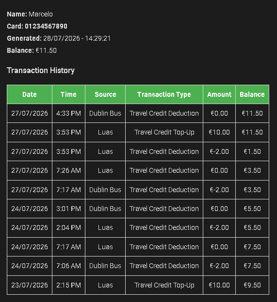

# LeapCard Balance

A Home Assistant Add-on that logs into [leapcard.ie](https://www.leapcard.ie) (TFI Ireland) and exposes your Leap Card balance and recent transaction history as a sensor.

<p align="center">
  
</p>

## Example

<p align="center">
  
</p>


## How authentication works

leapcard.ie authenticates through Azure AD B2C, using a custom policy with a hybrid OAuth2/OIDC flow. Instead of a full form-post round trip through a browser, this add-on drives that flow directly over HTTP with `requests` + `BeautifulSoup`:

1. Request the protected page and follow the redirect into the B2C login flow, picking up a fresh CSRF token and transaction ID along the way.
2. Submit your credentials to B2C's `SelfAsserted` endpoint.
3. Call the `confirmed` endpoint, which returns an auto-submitting form carrying a signed `code` + `id_token`.
4. Resubmit that form back to leapcard.ie, which sets the session cookie that authenticates every subsequent request.

No browser engine is involved at any point — just a handful of well-understood HTTP calls, kept alive in a single `requests.Session()`.

## Features

- Pure Python login flow, no browser engine required
- Exposes a single `sensor.leapcard` entity with your current balance as the state
- Attributes include your name, card number, last update time, and your 10 most recent transactions
- Publishes over MQTT using [MQTT discovery](https://www.home-assistant.io/integrations/mqtt/#mqtt-discovery) with retained messages, so the entity and its last known values survive a Home Assistant restart
- Configurable polling interval (defaults to once a day, matching LeapCard's own recommendation to avoid rate limiting)

## Installation

1. Make sure you have a working MQTT broker reachable from Home Assistant (either the official Mosquitto add-on, or an external broker), with the [MQTT integration](https://www.home-assistant.io/integrations/mqtt/) configured in Home Assistant.
2. In Home Assistant, go to **Settings → Add-ons → Add-on Store**.
3. Click the **⋮** menu (top right) → **Repositories**, and add:
   ```
   https://github.com/maroliar/ha-addon-leapcard-balance
   ```
4. Find **LeapCard Balance** in the store and click **Install**.
5. Go to the **Configuration** tab and fill in:
   - `leapcard_username` — your leapcard.ie login email
   - `leapcard_password` — your leapcard.ie password
   - `update_interval_minutes` — how often to check (default: `1440`, once a day)
   - `mqtt.host`, `mqtt.port`, `mqtt.user`, `mqtt.pass` — your broker's connection details
6. Start the add-on. Check the **Log** tab to confirm it logged in and published to MQTT successfully.

## The sensor

`sensor.leapcard`

| Field | Description |
|---|---|
| state | Current travel credit balance (€) |
| `name` | Account holder's first name |
| `card_number` | The Leap Card number currently linked to your account |
| `generated_at` | Timestamp of the last successful update |
| `history` | List of the 10 most recent transactions (`date`, `time`, `source`, `transaction_type`, `amount`, `balance`) |

## Dashboard card (optional)

This card requires the [html-template-card](https://github.com/PiotrMachowski/lovelace-html-template-card) custom card from HACS.

```yaml
type: custom:html-template-card
ignore_line_breaks: true
entities:
  - sensor.leapcard
content: |
  <style>
    body { font-family: sans-serif; padding: 20px; }
    table { border-collapse: collapse; }
    th, td { border: 1px solid #ddd; padding: 8px; text-align: center; }
    th { background-color: #4CAF50; color: white; }
    h1 { margin-bottom: 0.2em; }
    h2 { margin-top: 1.5em; }
    p { margin: 0.2em 0; }
  </style>
  <p><strong>Name: </strong>{{ state_attr('sensor.leapcard', 'name') }}</p>
  <p><strong>Card: </strong>{{ state_attr('sensor.leapcard', 'card_number') }}</p>
  <p><strong>Generated: </strong>{{ state_attr('sensor.leapcard', 'generated_at') }}</p>
  <p><strong>Balance: </strong>€{{ states('sensor.leapcard') }}</p>
  <h3>Transaction History</h3>
  
  
    <table>
      <thead>
        <tr>
          <th>Date</th><th>Time</th><th>Source</th><th>Transaction Type</th><th>Amount</th><th>Balance</th>
        </tr>
      </thead>
      <tbody>
        
        <tr>
          <td>{{ row.date }}</td>
          <td>{{ row.time }}</td>
          <td>{{ row.source }}</td>
          <td>{{ row.transaction_type }}</td>
          <td>€{{ row.amount | replace('€', '') }}</td>
          <td>€{{ row.balance | replace('€', '') }}</td>
        </tr>
        
      </tbody>
    </table>
  
    <p style="text-align:center;">No data found</p>
  
```

> **Tip:** `sensor.leapcard` stores its full transaction history as an attribute, which the [recorder](https://www.home-assistant.io/integrations/recorder/) will snapshot on every update. If you want to avoid growing your database with repeated copies of the same list, exclude the entity from attribute history:
> ```yaml
> recorder:
>   exclude:
>     entities:
>       - sensor.leapcard
> ```

## Known limitations

- If your account has more than one Leap Card registered, this add-on only reads whichever card is selected by default on leapcard.ie — card selection is planned for a future release.
- Data on leapcard.ie itself can take 24–48 hours to reflect your most recent trips (this is a limitation of LeapCard's own system, not this add-on).
- If `mqtt.user`/`mqtt.pass` are left blank (e.g. for a broker allowing anonymous connections), the add-on still sends empty-string credentials rather than omitting authentication — this may be rejected by some broker configurations. Tracked for a future fix.

## Roadmap

- [ ] Support selecting which card to pull data from, for accounts with multiple cards
- [ ] Additional account fields (card status, type, issue/expiry dates, auto top-up status)
- [ ] UI translations for the Configuration screen

## License

[MIT](LICENSE)